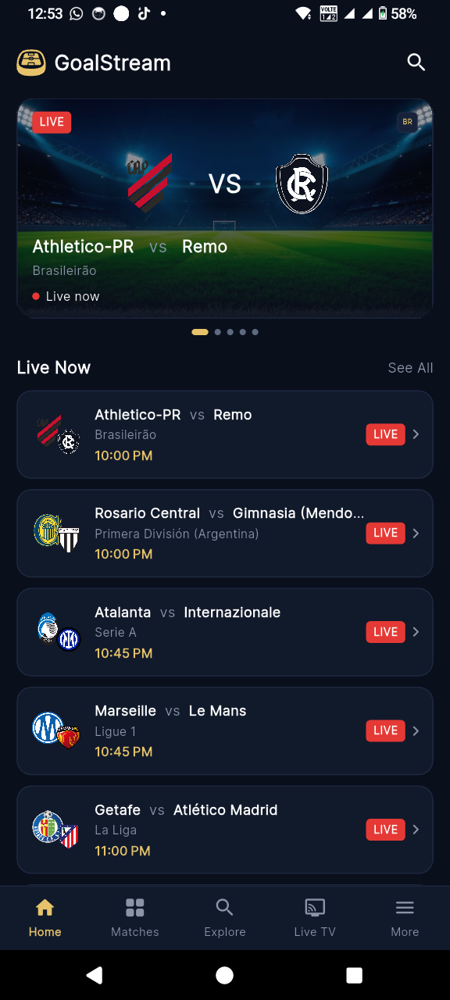
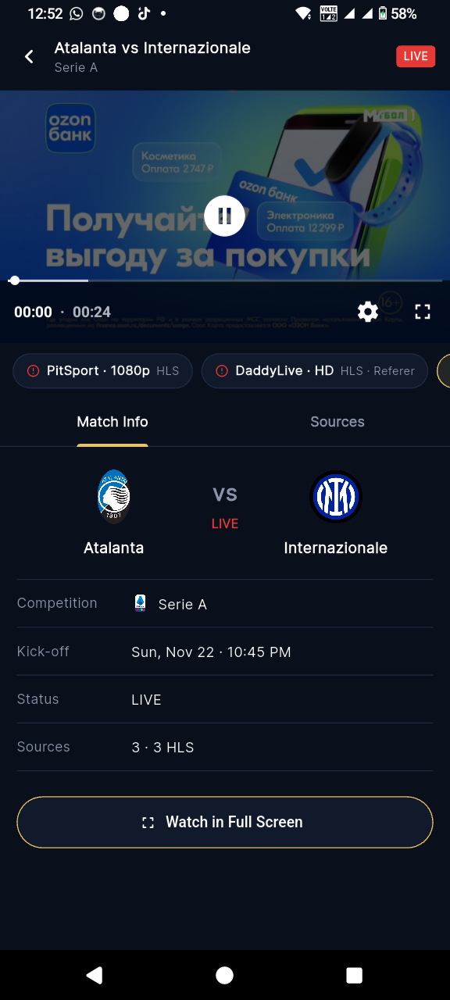
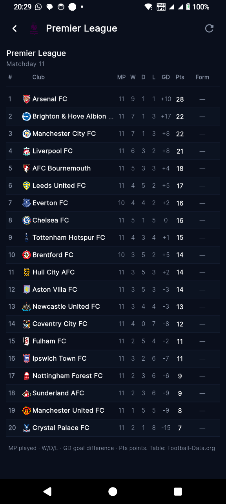

# GoalStream

GoalStream is a self-hosted Android football app: live matches, working
streams, replays, match stats and line-ups, league tables and real team crests.
Everything is served from a small Node bridge that runs on your own PC — no
account and no cloud service. The phone talks to your computer over the same
Wi-Fi.

[**Download the APK**](https://github.com/01annanogero-coder/goalstream-releases/releases/latest) ·
[**Get your API Hub key**](https://api.annandigitallabs.com) ·
[**Live-sport plugin**](https://github.com/rajhodedara/live-sport-plugin)

| Home | Match | League table |
|:--:|:--:|:--:|
|  |  |  |

---

## How it works

```
┌──────────────────────────┐        HTTP over Wi-Fi
│  GoalStream (Flutter)    │  ───────────────────────┐
│  Android phone           │                         │
└──────────────────────────┘                         ▼
                                        ┌────────────────────────────┐
                                        │  GoalStream bridge (:8080) │
                                        │  Node.js, no dependencies  │
                                        └─────────────┬──────────────┘
                                                      │ /api/matches, /stream/...
                                                      ▼
                                        ┌────────────────────────────┐
                                        │ live-sport-plugin (:7000)  │
                                        │  scrapers + stream resolver│
                                        └─────────────┬──────────────┘
                                                      │
                             public sports sources ◄─┘

Bridge also talks to (all optional):
  • API-Football      → score, stats, events, line-ups
  • Football-Data.org → league tables
  • ESPN / Wikipedia  → crest fallback for teams with no logo
```

1. **The plugin** builds a catalogue of live, upcoming and finished matches and
   resolves stream URLs for a single match on demand.
2. **The bridge** normalises that catalogue for the app: stable IDs, league
   names, team badges, scores, and a status computed from the kick-off clock.
   It caches the catalogue, resolves streams once per match, and adds playback
   headers.
3. **The app** shows Home / Matches / Explore / Live TV / More. Video plays in a
   native ExoPlayer view; YouTube highlights play in an embedded player.
4. **Crests** come from the match data first. When a provider sends none, the
   bridge looks the club up on ESPN, then Wikipedia; if both fail the app draws
   the team's initials.
5. **Live status** is clock-authoritative: a match is live from kick-off until
   2.5 h after (covers extra time), then it is finished — even if a provider's
   flag is stale. The app refreshes every 60 s.
6. **Updates**: on launch the app checks the public releases repo, downloads a
   newer APK on Wi-Fi, verifies its size/SHA-256 and hands it to Android's
   installer.

---

## What you need

| Requirement | Notes |
|---|---|
| A PC (Windows, macOS or Linux) | Runs both Node services; keep it awake while watching |
| [Node.js 22+](https://nodejs.org/) | `node -v` must print v22 or newer |
| [live-sport-plugin](https://github.com/rajhodedara/live-sport-plugin) | The match/stream source; MIT licensed |
| Android phone | Android 7+ (minSdk 24); same Wi-Fi as the PC |
| Flutter 3.47+ / Android SDK | Only if you build the APK yourself |
| API keys | Optional — see [APIs](#apis-you-need) |

The prebuilt APK is for convenience: it is **compiled with the author's LAN
address** (`192.168.8.152:8080`) and **contains no API Hub key**. To point it at
*your* PC you either build the app from source with your IP, or give your PC
that exact address. Live TV needs your own Hub key — see
[API Hub keys](#api-hub-keys).

---

## Quick start (Windows)

> **The app and bridge source is private.** The public release is the APK. The
> steps below are for the maintainer and for people who were given source
> access. Everyone else can download the APK and read
> [APIs you need](#apis-you-need) — Live TV needs your own API Hub key.

Clone the two repositories **side by side** so the launcher finds the plugin:

```bat
cd %USERPROFILE%\Desktop
git clone https://github.com/rajhodedara/live-sport-plugin.git
git clone <your private GoalStream source URL> goalstream
```

### 1. Build and prepare the plugin

```bat
cd live-sport-plugin
npm install
npm run timezone:prepare
set ICU_TIMEZONE_FILES_DIR=%CD%\.timezone-data\2026f-le
npm run build:local
```

`build:local` produces `dist/index.js`, which is what `npm start` and the
launcher expect.

### 2. Configure the bridge

```bat
cd ..\goalstream\bridge
copy .env.example .env
notepad .env
```

Paste your keys (or leave them blank — the app still works without them):

```ini
APIFOOTBALL_KEY=your_api_football_key
FOOTBALL_DATA_KEY=your_football_data_key
```

### 3. Start everything

```bat
cd ..
start-all.cmd
```

The launcher:

- finds `..\live-sport-plugin` (or takes a path as its first argument);
- starts the plugin on **:7000** and the bridge on **:8080**, skipping whichever
  is already running;
- waits until both answer, so you never start the app against a half-ready
  server;
- prints the phone URL and checks it against `goalstream\env.json`.

You can also double-click `start-all.cmd`, or create a Desktop shortcut with
`install-desktop-shortcut.cmd`. `stop-all.cmd` stops both services, and
`enable-autostart.cmd` starts them at sign-in.

### 4. Point the app at your PC

The app needs your PC's LAN IPv4 address (for example `192.168.1.100`), **not**
`127.0.0.1`. Find it with `ipconfig` and look for the Wi-Fi/Ethernet adapter.

```bat
cd goalstream
copy env.example.json env.json
notepad env.json
```

```json
{
  "STREAM_API_URL": "http://192.168.1.100:8080",
  "HUB_API_KEY": ""
}
```

`HUB_API_KEY` is only needed for the Live TV tab. Get **your own** key at
[api.annandigitallabs.com](https://api.annandigitallabs.com) — keys are issued
per user and are never shared. The published APK ships with this empty.

### 5. Install the app

Either download the APK from the
[latest release](https://github.com/01annanogero-coder/goalstream-releases/releases/latest)
and open it on the phone (allow "install unknown apps"), or build it yourself:

```bat
cd goalstream
flutter pub get
flutter build apk --release --dart-define-from-file=env.json
adb install -r build\app\outputs\flutter-apk\app-release.apk
```

The release APK is signed with a debug key — fine for personal sideloading, not
for the Play Store.

> **If the phone showed “Could not load matches”** while the server was off,
> tap **Try again** once `start-all.cmd` says the bridge is ready.

---

## Quick start (macOS / Linux)

The `.cmd` launcher is Windows-only; the services are the same two commands.

```bash
# terminal 1 — plugin
git clone https://github.com/rajhodedara/live-sport-plugin.git
cd live-sport-plugin
npm install
npm run timezone:prepare
export ICU_TIMEZONE_FILES_DIR="$PWD/.timezone-data/2026f-le"
npm run build:local
npm start
```

```bash
# terminal 2 — bridge
cd goalstream/bridge
cp .env.example .env
$EDITOR .env
node server.js
```

Then follow steps 4–5 above (`flutter build apk ...`). For an Android emulator,
use `http://10.0.2.2:8080` as `STREAM_API_URL`.

---

## APIs you need

Only the plugin is required. The rest add features; the app degrades gracefully
without them.

| API | Used for | Where the key goes | Free plan |
|---|---|---|---|
| [live-sport-plugin](https://github.com/rajhodedara/live-sport-plugin) | match catalogue, stream resolution, replays | self-hosted on `:7000` | free, MIT |
| [API-Football](https://www.api-football.com/) ([dashboard](https://dashboard.api-football.com/register)) | score, possession stats, events, line-ups | `APIFOOTBALL_KEY` in `bridge/.env` | 100 requests/day |
| [Football-Data.org](https://www.football-data.org/client/register) | league tables (13 competitions) | `FOOTBALL_DATA_KEY` in `bridge/.env` | 10 requests/minute |
| ESPN search API | crest fallback | none — bridge only | public |
| Wikipedia API | crest fallback for smaller clubs | none — bridge only | public |
| [API Hub](https://api.annandigitallabs.com) | Live TV channels | **your own** `HUB_API_KEY` in `goalstream/env.json` | per account |

Notes:

- **API-Football** is the scarce one. The bridge caps itself at 90 calls/day
  (`APIFOOTBALL_DAILY_LIMIT`), caches responses and only enriches a match when
  you open it. The quota resets at **00:00 UTC**.
- **Football-Data.org** returns `X-Requests-Available-Minute` and
  `X-RequestCounter-Reset`; the bridge reads both and answers with
  `rate_limited` + `retry_after` instead of hammering the API. Tables are
  cached for 10 minutes.
- Competitions outside Football-Data's free 13 (Premier League, Championship,
  La Liga, Serie A, Bundesliga, Ligue 1, Eredivisie, Primeira Liga, Brasileirão,
  Champions League, Copa Libertadores, Euro, World Cup) show a short
  “not covered” message instead of an empty table.
- Keys stay on your PC. The bridge has **no authentication** — anyone on your
  LAN can call it. Do not expose port 8080 to the internet as-is.

---

## API Hub keys

API Hub keys are issued **per user** by Annan Digital Labs at
[api.annandigitallabs.com](https://api.annandigitallabs.com). The author does
not provide, share or publish keys.

- The APK on the releases page is built **without** a Hub key, so Live TV is
  off by default. To enable it, put your own key in `goalstream/env.json` and
  build the app yourself.
- Keys are compiled into the APK. Never put someone else's key in a build you
  share, and never commit `env.json` or `bridge/.env` (both are git-ignored).
- If a key leaks — a shared APK, a screenshot, a log — revoke it in the API Hub
  dashboard and issue a new one. Treat any key found in a public build as
  compromised.

---

## Project layout

| Path | What it is |
|---|---|
| `goalstream/` | Flutter app (Android) |
| `bridge/` | Node API bridge; no npm dependencies |
| `start-all.cmd` | One-click launcher for Windows |
| `stop-all.cmd` | Stops the services on :7000 / :8080 |
| `install-desktop-shortcut.cmd` | Creates the “GoalStream Server” desktop shortcut |
| `enable-autostart.cmd` / `disable-autostart.cmd` | Optional start at sign-in |
| `goalstream.ico` | Shortcut icon |
| `artifacts/screenshots/` | Screenshots used above |
| `bridge/README.md`, `goalstream/README.md` | Deeper notes per part |

### Bridge HTTP API

| Endpoint | Purpose |
|---|---|
| `GET /health` | status, match counts, API quota |
| `GET /v1/matches?status=live\|vs\|ft&date=YYYY-MM-DD&league=…&q=…&page=1&per_page=20` | paged matches |
| `GET /v1/leagues` | leagues with live/upcoming counts |
| `GET /v1/matches/:id` | one match |
| `GET /v1/matches/:id/streams` | playable servers + external highlights |
| `GET /v1/matches/:id/insights` | API-Football stats/events/line-ups |
| `GET /v1/badge/team?name=TEAM` | redirects to a crest or 404 |
| `GET /v1/standings?league=LEAGUE` | Football-Data table |
| `GET /v1/export/fixtures` | fixtures as JSON for another frontend |

---

## How the pieces behave

**Streams.** The bridge asks the plugin for one match’s sources, normalises
them to `{name, url, header, type}`, and the app plays the first that works,
switching automatically if one fails. Some matches only have YouTube
highlights; those open in the app’s embedded YouTube player.

**Teammates and badges.** Provider logos win. Otherwise the bridge tries ESPN's
public search (only when it has a real image), then Wikipedia page images, with
provider abbreviations expanded (`Ch Odesa` → Chornomorets Odesa). Lookups are
cached on disk forever; misses for a week. Unknown teams get an initials badge.

**Leagues and tables.** Football-Data.org supplies position, MP, W/D/L, goals
and points. Its free plan does not include recent form, so that column shows
“—”.

**Updates.** The app reads
`api.github.com/repos/01annanogero-coder/goalstream-releases/releases/latest`,
compares `versionName`, downloads on Wi-Fi only, verifies size and SHA-256, and
launches Android's installer. You can also force a check in **More → Check for
updates**.

---

## Build and test from source

```bash
# bridge (no install step; Node 22.8+)
cd bridge
node --test --test-isolation=none test/

# app
cd goalstream
flutter pub get
flutter analyze
flutter test
flutter build apk --release --dart-define-from-file=env.json
```

The release toolchain is Flutter 3.47 / Dart 3.13, Android minSdk 24,
targetSdk 36.

---

## Troubleshooting

| Symptom | Check |
|---|---|
| “Could not load matches” / “server took too long” | Is the bridge running? Open `http://<PC-IP>:8080/health` in the phone browser while on Wi-Fi |
| Phone cannot reach the PC at all | Same Wi-Fi (not guest network); Windows Firewall allows Node on private networks; correct `STREAM_API_URL` |
| Address stopped working after a reboot | The router gave the PC a new IP. Reserve a DHCP lease, or update `env.json` and rebuild. `start-all.cmd` warns when the IP changes |
| Something already uses :7000 or :8080 | `netstat -ano \| findstr :8080` then stop that process, or set `BRIDGE_PORT` in `bridge/.env` (and update `env.json`) |
| No stats or line-ups | `APIFOOTBALL_KEY` missing, or the 100/day quota is spent (resets 00:00 UTC) |
| Table says “not covered” | The competition is not in Football-Data's free 13 |
| Table says “rate limited” | Wait the shown number of seconds; tables are cached 10 minutes |
| Some teams still show initials | Neither ESPN nor Wikipedia had a matching crest; this is the intentional fallback |
| Play Protect warns about the APK | Normal for a sideloaded, self-signed build; choose “Install anyway” |
| Plugin window closes immediately | Build it first: `npm run build:local`; check the timezone folder and Node version |

Logs are in the two service windows opened by `start-all.cmd`; the bridge also
prints request errors there.

---

## Notes

- **No API Hub key is shipped in the public APK.** Live TV requires your own
  key and your own build; see [API Hub keys](#api-hub-keys).
- The app and bridge source is private; the public repository hosts the README
  and release APKs.
- The bridge serves **your** LAN. It has no login; keep it off the public
  internet unless you add authentication and TLS in front of it.
- Streams are resolved from third-party public sources by the plugin. This
  project does not host or store video; use it for personal viewing and follow
  the laws and terms that apply to you.
- Club crests are referenced from ESPN/Wikipedia (some are non-free club logos);
  they are not bundled in the APK.
- No warranty. Provider sites change often; a source that worked yesterday may
  need a plugin update today.

## Credits

- [live-sport-plugin](https://github.com/rajhodedara/live-sport-plugin) by
  rajhodedara — the match catalogue and stream resolver (MIT).
- [API-Football](https://www.api-football.com/) for match data.
- [Football-Data.org](https://www.football-data.org/) for league tables.
- ESPN and Wikipedia for crest lookups.
